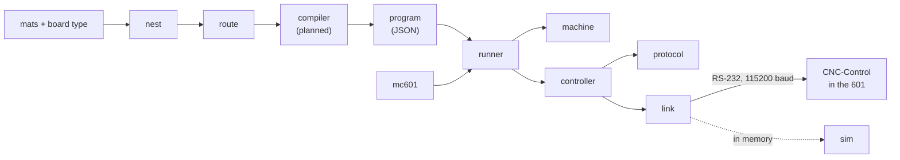

# 601rs

**Drive a Gunnar 601 mat cutter from any computer.**

[](#licence)
[](https://www.rust-lang.org)


601rs is an open driver for the 601, written in Rust. It speaks the RS-232 protocol of the
CNC-Control controller inside the machine, and runs, checks and calibrates the cutter from
macOS, Linux or Windows. `mc601` is its command line.

> [!NOTE]
> **Not affiliated with Gunnar.** 601rs is an independent project, not made, endorsed or
> supported by Gunnar, the maker of the 601. Gunnar and GMC are trademarks of their owners and
> appear here only to say which machine this drives and which software it works alongside.

> [!WARNING]
> **It moves a machine with a blade in it.** It has run on one 601 so far. Read
> [`docs/hardware-testing.md`](docs/hardware-testing.md) before you point it at a machine, stay
> within reach of the machine's stop button, and expect bugs. It comes with no warranty (see
> the licences).

## What it does

- **Cuts programs** (`mc601 run`): mats described as JSON ([`PROGRAM_FORMAT.md`](PROGRAM_FORMAT.md)),
  checked against the machine's limits before anything moves. Pause and cancel between cuts,
  holds on the green button, stop at once from anywhere, and a safe machine (heads up, clamps
  released) after any failure.
- **Stops promptly.** A stop takes its own lane past everything else, and the serial writer keeps
  pace with the line, so a stop never waits behind a backlog of queued vectors.
- **Checks the machine** (`mc601 probe`, `mc601 check`): eight stages, from read-only questions to
  every move, asking before each step and logging every byte both ways.
- **Calibrates the heads** (`mc601 calibrate`): cut one sheet, type in what the ruler says, and a
  least-squares fit of the blade model gives each head's offset, drag and slit.
- **Orders the cuts** ([`route`](crates/route)) so the head travels least within the cutting
  rules, and **nests mats onto sheets** ([`nest`](crates/nest)) and into other mats' drop-outs.
- **Simulates the controller** ([`sim`](crates/sim)), held to the real thing: `cargo test`
  replays every serial capture of GMC and every session log from the machine against it.

## Quick start

```sh
cargo install --path crates/mc601    # puts `mc601` on the PATH

mc601 check --sim                    # every hardware check, against the simulator
mc601 run --sim testdata/programs/g_regular_mount.json

mc601 probe                          # at the machine: read-only, nothing moves
mc601 run job.json                   # cut a program, asking before each
```

The port is found by itself when one USB-serial adapter is plugged in; `mc601 --help` has the
rest.

## How it fits together



Each layer is a crate, and a crate depends only on crates below it in this table.

| Crate | What it does |
|-------|--------------|
| `station` *(planned)* | Service on the machine PC: the queue, an HTTP API and events for apps; starts cuts only from the machine's own screen. |
| [`nest`](crates/nest) | Places mats on sheets of their board type, and in other mats' drop-outs: three-stage guillotine layouts by iterative beam search (after PackingSolver), offcuts before full sheets, every layout checked before it is returned. |
| `compiler` *(planned)* | Geometry and a profile in, a program out: flattening, overcut, overlap, cut order. |
| `profile` *(planned)* | Board types: speed, trims, overcut, overlap, start speed. |
| [`route`](crates/route) | The cut order: which cut next and which way round, so the head travels least, within the cutting rules. |
| [`runner`](crates/runner) | Drives the cutter: configures the controller, homes, runs programs and manual moves; pause, cancel, holds, stop now, a safe state after any failure, events. |
| [`machine`](crates/machine) | The machine model, pure: profile, mm and degrees to steps, each cut lowered as one unit (GMC's form, held to its captures, or one stream per cut), soft limits, run time, the line's byte budget. |
| [`controller`](crates/controller) | Valid commands only: one outstanding at a time, replies matched with deadlines, mode tracking, the stop lane, async signals. |
| [`protocol`](crates/protocol) | Pure codec: commands to bytes, bytes to replies. No I/O, no clock. |
| [`link`](crates/link) | Reader and writer halves: a serial port paced to the line, an in-memory pair, a byte tap. |
| [`sim`](crates/sim) | The controller simulator behind an in-memory link, for tests and dry runs; checked against every GMC capture and session log. |
| [`program`](crates/program) | The program format: types, parsing, validation. |
| [`mc601`](crates/mc601) | The command line: `run`, `calibrate`, `check`, `probe`, `logs`, `config`, `ports`, `capture`. |

**Invariant:** commands this software must never send (mode 9 file transfer, firmware upload,
parameter save `#W`) cannot be represented in `protocol::Command`.

## Performance

Measured on an Apple M1 Max (one thread) with `rustc 1.97`, release build. The benchmarks are
plain examples with fixed seeds, so the numbers reproduce.

### Cut order: [`route`](crates/route)

Head-up travel is dead time on every sheet. The optimiser is iterated local search with
ruin-and-recreate kicks, and every route it returns keeps the cutting rules (openings before
their mat's border, bevel edges clockwise). Here it plans one sheet per size, against cutting
mat by mat in a fixed order and against always going to the nearest cut, with travel at the
601's 900 mm/s and 4,000 mm/s², from the park and back:

| Mats | Cuts | Fixed order | Nearest first | **Optimised** | Saved vs nearest first | Median time |
|-----:|-----:|------------:|--------------:|--------------:|-----------------------:|------------:|
| 1 | 12 | 5.0 s | 4.2 s | **2.4 s** | 42 % | 21 ms |
| 2 | 16 | 4.7 s | 3.7 s | **2.6 s** | 30 % | 28 ms |
| 4 | 60 | 10.7 s | 7.4 s | **5.1 s** | 31 % | 249 ms |
| 6 | 80 | 11.5 s | 8.5 s | **6.1 s** | 29 % | 265 ms |
| 9 | 104 | 15.0 s | 10.0 s | **6.8 s** | 32 % | 289 ms |
| 12 | 132 | 16.5 s | 11.0 s | **8.0 s** | 27 % | 299 ms |

On GMC's own twin-window job (`g_multi_C10`), the same cuts in the optimiser's order travel
0.32 m between cuts instead of GMC's 1.53 m ([reference §4](PROTOCOL_REFERENCE.md#4-cut-sequence-state-machine)).

```sh
cargo run --release -p route --example bench
```

### Nesting: [`nest`](crates/nest)

Ten random queues per size, of common mat sizes from 8 × 10 in to 60 × 80 cm (most free to
turn), on 32 × 40 in sheets with a 5 mm trim:

| Mats | Sheets used | Lower bound | Sheet use | Median time | Slowest |
|-----:|------------:|------------:|----------:|------------:|--------:|
| 8 | 3.5 | 3.1 | 64 % | 1 ms | 4 ms |
| 20 | 5.7 | 5.1 | 74 % | 46 ms | 61 ms |
| 40 | 10.7 | 9.7 | 78 % | 134 ms | 180 ms |
| 80 | 22.4 | 18.7 | 78 % | 377 ms | 453 ms |
| 160 | 43.8 | 37.0 | 81 % | 981 ms | 1,252 ms |

No layout can use fewer sheets than the lower bound (the mats' area, or the mats too big to
share a sheet), but guillotine cuts seldom reach it, so it is a floor rather than a target. The
fairer yardstick is PackingSolver, whose method the nester reimplements: during development,
against PackingSolver's results on 195 queues of 4 to about 160 mats, it matched the sheet count
on every one. `--example bench` replays a file of such reference results.

```sh
cargo run --release -p nest --example queues
```

### The serial line: [`link`](crates/link) and [`machine`](crates/machine)

At 115200 baud the line carries 11,520 bytes/s, and on a fast curve the controller uses path
data faster than that. For the oval in GMC's capture, cut at 95 % speed
([reference §5](PROTOCOL_REFERENCE.md#5-pacing-the-x-loop-and-buffering)):

| Encoding of the oval | Vectors | Bytes | Share of the line |
|----------------------|--------:|------:|------------------:|
| GMC: an absolute `L20,X,Y,Z` for every point | 1,107 | 24,250 | **194 %**: the buffer starves and the cut hesitates |
| 601rs: within 0.02 mm and 2° of turn per point, compact relative steps | 425 | 5,419 | **43 %** |

A stop goes out behind at most 64 queued bytes, about 6 ms of line (by the writer's design; yet
to be timed at the machine). Before the writer was paced, a stop at the machine waited behind
about 11 KB, close to a second.

## How it was built

From the controller's programming manual (CNC-Control v1.00, SIG Positec), serial captures of
GMC (Gunnar's own software) driving a 601, sessions on that machine, and study of how GMC drives
it. [`PROTOCOL_REFERENCE.md`](PROTOCOL_REFERENCE.md) gives the source of every fact. The
repository holds no code or documents from GMC or from the controller's maker; the captures in
`testdata/captures/` are recordings of the serial line, with the controller's licence file
blanked.

- [`PROTOCOL_REFERENCE.md`](PROTOCOL_REFERENCE.md): the wire protocol, the cut sequence, calibration, with citations
- [`PROGRAM_FORMAT.md`](PROGRAM_FORMAT.md): the program format, the contract between the compiler and the runner
- [`DIAGNOSTIC_TOOL_SPEC.md`](DIAGNOSTIC_TOOL_SPEC.md): the calibration and diagnostic routines
- [`docs/hardware-testing.md`](docs/hardware-testing.md): running `mc601 probe` and `mc601 check` at the machine

## Build and test

```sh
cargo test       # unit tests, end-to-end runs against the simulator, and every capture replayed
cargo run -p mc601 -- capture testdata/captures/g_init.txt    # read a GMC serial capture
```

## Licence

Licensed under either of the [Apache License, Version 2.0](LICENSE-APACHE) or the
[MIT licence](LICENSE-MIT), at your option. Unless you explicitly state otherwise, any
contribution intentionally submitted for inclusion in the work by you, as defined in the
Apache-2.0 licence, shall be dual licensed as above, without any additional terms or
conditions.

Third-party notices: [`THIRD-PARTY-NOTICES.md`](THIRD-PARTY-NOTICES.md).
